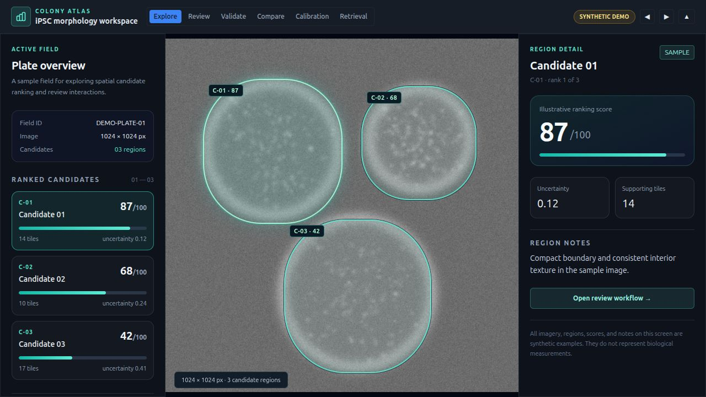
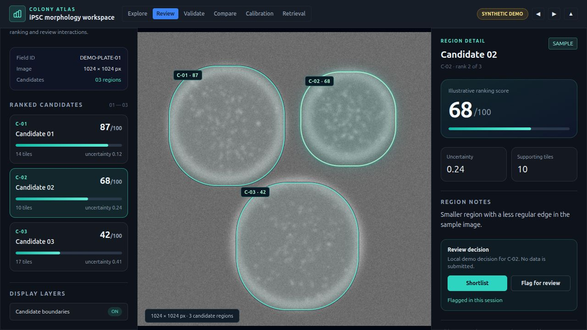

# iPSC Colony Classification

An experimental image analysis pipeline for exploring how induced pluripotent stem cell (iPSC) colonies can be ranked from grayscale microscopy images. The repository combines a reproducible Python workflow with a separate, interactive review interface.

The pipeline converts source images, extracts candidate tiles, generates weak training labels, trains a grayscale ResNet18 classifier, and exports ranked colony regions with heatmaps and machine readable reports. A local platform service now connects imported images and analysis output to a simple technician inbox and review screen. The separate visual demo still uses clearly marked synthetic data.



*Interactive workspace with a synthetic plate image and illustrative candidate scores. No biological measurements are shown.*

## Why this project

A tile prediction by itself does not tell a reviewer where a colony is or how several predictions relate across an image. This project keeps image coordinates throughout the workflow, groups neighboring tile predictions into candidate regions, and produces visual and structured outputs that can be inspected together.

## What is implemented

| Area | Current behavior |
| --- | --- |
| Preprocessing | Converts PNG, JPEG, and TIFF images to normalized grayscale PNGs. |
| Candidate extraction | Splits images into 256 × 256 tiles and filters low texture or low edge content. |
| Training data | Generates image statistics based weak labels and supports manual label overrides. |
| Model | Adapts ResNet18 for one channel input and three classes: `bad`, `likely_good`, and `uncertain`. Training combines weighted classification, augmented view consistency, and a pairwise ranking term. |
| Plate analysis | Predicts tile scores, groups nearby tiles into candidate regions, ranks them, and writes JSON, CSV, heatmap, and overlay files. |
| Review interface | A Next.js inbox and field review page for importing real images, starting analysis, inspecting candidates, saving decisions, and exporting records. A separate synthetic workspace remains available. |

The stages are separate scripts and leave intermediate artifacts on disk, making it possible to inspect each step. Stage markers skip preprocessing and training work when their inputs and configuration have not changed.

## Local platform service

The repository now includes a local HTTP service for importing microscopy fields, queuing analyses, storing results, and recording review decisions in SQLite. Source images are stored by SHA-256 digest; jobs and decisions survive process restarts. It binds to `127.0.0.1` by default and stores its state in the ignored `platform_data/` directory.

```bash
./linux-v1/run.sh service
```

The service listens on `http://127.0.0.1:8765`. `GET /health` checks availability. Its current API accepts raw PNG, JPEG, or TIFF bytes at `POST /api/fields` with an `X-Filename` header; `POST /api/fields/{id}/jobs` queues analysis. The browser uses a bounded JPEG preview while the original stays available for download. `GET /api/fields/{id}/export` returns the field, latest analysis, and decision history. A trained `model.pth` must be installed before analysis jobs can succeed. The service is currently a single-machine research deployment and has no user authentication; do not expose its port on a shared network.

See [local platform operations](docs/operations.md) for service checks, queue visibility, optional local workers, backup and restore, access boundaries, job recovery, and model provenance. The [single-host deployment guide](docs/deployment.md) includes production process units and access boundaries.

Run the service and frontend in separate terminals:

```bash
./linux-v1/run.sh service
./linux-v1/run.sh frontend
```

The browser opens to the field inbox at `http://127.0.0.1:3000`. Select an image to import it, open the field, run analysis, and record a review decision. The Next.js server forwards `/api/platform/*` to the local Python service; `ATLAS_API_URL` can override its default `http://127.0.0.1:8765` target. The browser never calls the Python service directly.

```text
raw/ → processed/ → tiles/ → tiles_clean/ → dataset/ → model.pth
                                              ↓
plate images → tile predictions → grouped regions → reports + visuals
```

## Interface preview



*Review mode shows a local, disposable decision on an illustrative candidate. The screenshots were captured from the running application.*

The [comparison view](docs/screenshots/colony-compare.png) shows the three sample rankings side by side.

The included [demo plate](frontend/public/demo-plate.png) and its scores are synthetic. The [smoke image](samples/smoke.png) exists solely to check that the Python pipeline runs. Neither is a training dataset or evidence of biological performance.

## Quick start on Linux

Use Python 3.12, Node.js, npm, and [`uv`](https://docs.astral.sh/uv/). The commands below install CPU PyTorch for a local smoke run.

```bash
uv venv --python 3.12 .venv
uv pip install --python .venv/bin/python numpy opencv-python pillow
uv pip install --python .venv/bin/python torch torchvision --index-url https://download.pytorch.org/whl/cpu

mkdir -p raw
cp samples/smoke.png raw/
./linux-v1/run.sh check
IPSC_PRETRAINED_WEIGHTS=0 ./linux-v1/run.sh pipeline
./linux-v1/run.sh analysis raw analysis_output
```

The smoke run creates `model.pth` and example files in `analysis_output/`. The resulting scores are meaningless because the model has seen only synthetic data. Remove those generated files before training on real images.

For the interface:

```bash
cd frontend
npm ci
cd ..
./linux-v1/run.sh frontend
```

Open [http://127.0.0.1:3000](http://127.0.0.1:3000). The main UI requires the service above. The standalone synthetic demo is at `/workspace`. `npm run build` in `frontend/` checks its production build.

### Using your own images

Place PNG, JPEG, or TIFF microscopy images under `raw/` and run `./linux-v1/run.sh pipeline`. This trains a model from the generated labels, with optional overrides in `manual_labels/labels.json`. Then run:

```bash
./linux-v1/run.sh analysis /path/to/plate-images analysis_output
```

The output contains `plate_report.json`, `plate_report.csv`, and image specific files under `visuals/`. The Python modules can also be invoked individually; [the Linux launcher](linux-v1/run.sh) is a convenient entry point. `requirements.txt` contains the backend dependencies for other Python installation workflows.

## Repository map

| Path | Responsibility |
| --- | --- |
| `convert_to_png.py`, `tile_images.py`, `filter_tiles.py` | Image normalization and tile preparation |
| `generate_labels.py`, `train.py` | Dataset assembly and model training |
| `model_inference.py`, `colony_analysis.py`, `run_analysis.py` | Inference, spatial grouping, and report export |
| `run_pipeline.py` | Staged training workflow and readiness check |
| `frontend/` | Standalone spatial review prototype |
| `samples/` | Synthetic smoke test input |

## Current limits

- Weak labels come from image statistics, which can reflect acquisition conditions rather than colony morphology. Manual or expert labels are needed for meaningful training.
- There is no held out biological validation, expert agreement study, or cross lab evaluation in this repository. Reported scores must not be interpreted as validated colony quality.
- An [evaluation protocol and CLI](docs/validation.md) are ready for independently annotated, held-out fields when partner data becomes available; no biological performance result is claimed here.
- The main frontend can display live analysis output and save review decisions. The separate `/workspace` synthetic demo still contains validation, calibration, and retrieval previews without measured artifacts.
- The local service has no verified user accounts, permissions, or multi-host job coordination yet. Online, integrity-checked backups cover its SQLite and filesystem storage; an optional systemd timer can schedule them.
- The analysis uses fixed size, nonoverlapping tiles; its region grouping is a heuristic over nearby tile boxes. It is not colony segmentation.
- The optional `--debug` analysis path requires a diagnostics module that is not included in this checkout.

This project is for research and software demonstration. It is not a clinical or laboratory decision tool.

## License

MIT. See [LICENSE](LICENSE). The bundled OpenSeadragon control images retain their [BSD 3-Clause license](frontend/public/vendor/openseadragon/LICENSE.txt).
